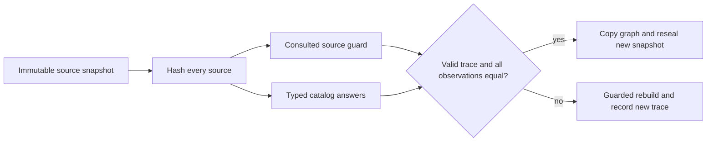

# Catalog-query study protocol

This is a prospective engineering study of process-local static graph reuse. The
machine-readable [protocol](../../benchmarks/catalog_reuse/protocol.json) defines
the frozen measurement rule and targets; a recorded protocol commit precedes
natural resolver outcomes. It is a local protocol freeze, not a public preregistration.

## Mechanism and controls

A is the existing `incremental_read_set`: all source-read hashes and the whole path
catalog must be unchanged. B exempts only valid zero-query graphs from the catalog
guard. C guards complete membership of every queried canonical module root.
D records exact ordered candidate tuples, including empty results, and namespace
existence booleans, including false. **D versus C is the primary comparison.**
All share the same guarded module-summary cache, fixed anchors, depth4/node256
policy and full-input source hashing. They preserve unknown/truncated outputs.
A changed relevant query, changed consulted source, missing trace or unsupported
trace version rebuilds. No externally supplied certificate is accepted.

The [conditional argument](CATALOG_SOUNDNESS.md) explains the assumptions. Core
reflection, dynamic dispatch and runtime import semantics are not established.
These research modes belong to `contextproof.reuse.GraphSession`; they are separate
from the persistent product `graph_session.GraphSession` and do not imply an
end-to-end CLI or agent speedup.



The catalog indexes all eligible paths and their dotted ancestors; every update
still reads/hashes all source bytes. Guards scale with consulted files and recorded
answers; comparing candidate tuples includes their lengths. A root guard may
compare an entire package. Graph copying/sealing still scales with retained graph
payload. Fine invalidation cannot remove these fixed costs.

`PYTHONPATH=src python examples/catalog_reuse.py` runs a small synthetic example
through all four actual modes. Adding an unrelated file inside the queried root
reuses only D; introducing a matching stub collision rebuilds every mode. The
example checks fresh canonical bytes and is a mechanism demo, not natural evidence.

## Prospective input selection

RQ, MCP Python SDK, Scrapy and Hatch supply distinct software domains. Each has a
fixed current upstream HEAD and128first-parent transitions; these are commit pins,
not claimed stable releases. The primary trajectory uses17equally-spaced snapshots
at ancestor offsets128,120,...,8,0, yielding16source updates, each batching8transitions.
All23immediate catalog-change event pairs within the same windows form a secondary
mechanism panel. Never infer ordinary-change cost from this conditioned panel.

At each earliest primary snapshot, sort unique direct module-body function keys
by SHA256(path+colon+symbol), then identity, and keep24. Duplicate direct declarations
remain ambiguous; later missing functions remain missing and are never replaced.
AST structural metadata was inspected before freeze. The sample is prospective to
candidate resolver outcomes, not a strict unviewed-source holdout or population sample.
MCP SDK is also an optional project integration dependency, a disclosed relationship.

[Selection evidence](../../benchmarks/catalog_reuse/selection.json) retains20live
candidate metadata records and17scanned histories. The stable-release plus8transition
rule lacked events. The strict newest8events in128transitions rule yielded0complete
viable sets among17. Before outcomes, it was revised to ordinary spaced snapshots
plus **all** events. Selected histories contain512transitions and864raw added/deleted
path entries:711non-Python,107outside prefixes,46included production paths affecting
23transitions. Exclusion order checks prefix before test/cache; a zero latter count
does not mean there were no test paths. The old preflight label “path events” counted
transitions, not individual changed paths.

## Verification, timing and resource gates

Zero canonical byte mismatches against fresh same-resolver construction is the hard
gate. A separate unmodified `ce6e36de7f6860296d66dadcb3105a8bbda9eb9a` fresh resolver
checks all107unique snapshots to catch a shared catalog-refactoring error. Neither
oracle proves Python semantics. Authored counterexamples are development regression
cases; their counts are not independent natural tasks or human-reviewed gold labels.

Use one complete warmup and five measured trajectories per method and repository,
rotating whole-method order; each trajectory begins with a new session. Time local
archive read/hash/decompression, source filtering/decoding/hash, initial anchor
capture and all session work including graph copying/resealing. Exclude network,
metadata parsing, oracles and result serialization. Report initial capture, the sum
of16replay updates and capture+replay total. This is warm-filesystem/cold-session
initialization, not machine cold start. No simultaneous performance runs are allowed.

The predeclared engineering target is >=20% lower median replay cost for D against C
in >=3/4repositories, with zero mismatches. Three fresh RSS subprocesses per method
and repository measure peak memory separately; target <=1GiB and <=2xC. These are
planning thresholds, not claimed measurements or scientific significance tests.
Every repetition, method, negative and failure is retained. Repositories, transitions,
anchors and repeated runs are dependent; no p-values or universal speedup claims.

## Reproduce

Install this research branch with `python -m pip install -e '.[dev]'`.
Download pinned inputs outside every Git tree, then run the frozen study:

```sh
python scripts/prepare_catalog_sources.py --output /tmp/catalog-study-inputs
PYTHONPATH=src python scripts/run_catalog_study.py \
  --inputs /tmp/catalog-study-inputs/ready-manifest.json \
  --protocol benchmarks/catalog_reuse/protocol.json \
  --output /tmp/catalog-study-results
```

Input archives retain their upstream licenses outside this repository. The public
artifact contains metadata, hashes and result digests, not upstream source bundles,
source snippets, credentials or personal logs. Public [raw run records](../../benchmarks/catalog_reuse/results/)
and the generated result report are added only after actual execution. Missing
results are never interpreted as passing. GPU/model/API calls are unnecessary.
