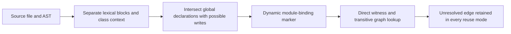

# Explicit function-global bindings: design and development evidence

Resolver **4** conservatively refuses a fixed module binding when a function or class block can explicitly rebind that name through `global`. This repairs a source-local reliability defect. It does not prove arbitrary Python semantics, accelerate the resolver, or establish a mature research result. The natural panel below produced **no newly improved watched binding**.

[中文](../zh/FUNCTION_GLOBAL_BINDINGS.md) · [Generated results](../../benchmarks/global_bindings/results/development-20261014/REPORT_en.md) · [Protocol](../../benchmarks/global_bindings/protocol.json) · [Fixed inputs](../../benchmarks/global_bindings/inputs.json)

## Problem and contribution boundary

A module can initialize `x = 0`, expose `getter()` returning `x`, and later change `x` in `writer()` with `global x`. The initial assignment alone cannot establish a fixed binding for an arbitrary later call to `getter()`. The former resolver could nevertheless select that literal declaration. The earlier Scrapy example is development diagnosis, explicitly excluded from the new eight-head panel; it is not an independent confirmation sample.

The separate [known-source Scrapy recheck](../../benchmarks/global_bindings/development-diagnosis/scrapy-known-source-recheck.json) retains two dependent versions of `get_scrapy_root_handler`: the watched binding changes from a resolved initializer to explicit-global uncertainty. Other frontiers remain. This is posthoc development evidence on a known getter, not two new tasks or a gain in the ten-anchor panel.

The repair identifies **possible explicit global binding writes**, retaining an unresolved edge with reason `explicit function/class global write may rebind this name`. A bare `global x`, a read of `x`, or a local write in another lexical block does not itself supply this marker. This is a conservative static guard, using established [Python name-binding rules](https://docs.python.org/3.12/reference/executionmodel.html#naming-and-binding); no new scope-analysis principle is claimed.

## Scope-aware implementation

The call path is `_Corpus` indexing → `guard_module_bindings` → `_binding_scopes` / `_scope_global_writes` → `resolve_name`. See [static_scope.py](../../src/contextproof/static_scope.py) and [dependencies.py](../../src/contextproof/dependencies.py).

1. Enumerate function, async-function and class blocks with their containing class context.
2. Within each block, collect declared global names and possible binding writes. Assignments, deletion, imports, declaration names, loop/context-manager targets, exception targets, match captures and assignment expressions contribute as supported by the guard.
3. Keep nested function/class bodies separate. Default expressions and other inspected definition expressions are visited in their surrounding context; comprehension iteration targets are local, while a comprehension assignment expression can write a surrounding function's declared global.
4. Apply [private-name mangling](https://docs.python.org/3.12/reference/expressions.html#private-name-mangling) to both declarations and writes. For a class `C`, a supported `global __name` targets `_C__name`, not the unrelated module name `__name`; leading underscores in class names and unchanged dunder names are covered by regression tests.
5. Add the dynamic marker before storing a module summary. Direct witnesses and transitive graphs share this binding table, including cached module summaries. Name resolution retains the marker as uncertainty instead of selecting an initial literal.



The work is source-local; it does not require a repository-wide call-order model. Hash/read-set reuse can preserve this **unknown output**, but cannot turn it into a semantic freshness certificate. There is no branch reachability or function-call proof. The unreachable-write fixture therefore remains unresolved although its observed execution does not change the value. This is an explicit precision cost.

## Versions and historical records

| Object | Fixed identity | Meaning |
|---|---|---|
| Baseline core | `09d6476ae5d42c9876d0df86b3b60dfa1c2ff048`, resolver 3 | Previous public research core |
| Candidate core | `99f09f4594e44fc0805b4d4a4599a0a6857490c3`, resolver 4 | Explicit global-write repair |
| Historical byte archive | `affa59024f70cde86d2549b690204aa73ddccc7d` | Its core file bytes equal the baseline fingerprint; no historical measurement is relabeled |
| Final baseline run | `globals-20261014T134920Z-baseline` | Retained development record |
| Final candidate run | `globals-20261014T134921Z-candidate` | Same inputs and amended protocol |

The [archive ledger](../../research/frozen-catalog-20261014-source/SOURCE_MAP.json) binds all 23 catalog measurement/core files to the measured commit. Historical catalog reports explicitly verify this archive and the sealed run. New catalog measurements still require the **current** implementation fingerprint to match their protocol; changing the core cannot silently reuse the old measured label.

Resolver 4 rejects older graph policies. Restart process-local sessions and recapture graphs after upgrading. Old resolver-2/3 artifacts, original protocols and their measured results remain historical evidence, not current certificates.

## What actually ran

The [paired raw records](../../benchmarks/global_bindings/results/development-20261014/) contain 32 developer-written fixtures per engine, plus 10 fixed natural anchors. They were run on Python 3.12.2 / macOS arm64. The graph runner executes only its fixed own fixtures; it reads upstream code as text. A separate reviewed runner executes the selected upstream assertions.

| Evidence | Actual outcome | Interpretation |
|---|---|---|
| 20 possible-write fixtures | Baseline resolved all 20; candidate retains all 20 unresolved | A measured conservative binding repair |
| 12 non-writing controls | Supported literal binding retained by both engines | Controls for unnecessary refusal in this specified matrix |
| Runtime checks of possible-write fixtures | 19 observed changes; 1 unreachable write leaves state unchanged | Runtime behavior plus a retained precision cost |
| Interface regression suite | 462 parameterized checks across public interfaces and reuse modes | Derived cases, not 462 independent experiments or an accuracy estimate |
| Eight new source heads | One production explicit-global writer found; seven zero-writer rows retained | No explicit match is not evidence of no dynamic mutation |
| Ten natural anchor graphs | All retain incomplete/unknown closure in both engines | No complete semantic certificate |
| Three watched Pyparsing binding keys | Unresolved → unresolved, already guarded by wildcard uncertainty | **Zero new natural binding gain** in this panel |
| Four upstream fix units | 43 fixed-version assertions pass; parent versions pass 15 and fail 28 | Four changes, not 43 repair tasks; no candidate-effect attribution |
| Pyparsing whole-method execution preflight | 23 selected methods, 200 state-observation events | Previously observed execution evidence, not candidate gain or 200 changes |

The 43 assertion outcomes and Pyparsing preflight were known before candidate graph measurement. The two TrimArity exception tests do not explicitly require an exception, so their passes alone do not establish exception correctness. Line/state traces describe observed execution; they are not necessary-context labels. Initial execution failures remain in [preflight-failures.json](../../benchmarks/global_bindings/upstream_execution/results/preflight-failures.json).

## Protocol amendments and inference limits

Both amendments are retained. [Original v1](../../benchmarks/global_bindings/protocol-original-v1.json) was amended before either graph role ran to retain failed rows, pair watched edges by source node/expression/operation, and reject unsafe paths or a wrong engine import. [Original v2](../../benchmarks/global_bindings/protocol-original-v2.json) was amended **after the first baseline** to replace `splitlines()` anchor slicing with physical `source_lines`, because Unicode separators are not physical source lines. Inputs and anchors did not change; the [first baseline](../../benchmarks/global_bindings/results/development-20261014/amendments/first-baseline-before-line-fix.json) remains, and both roles were rerun.

No candidate natural-panel graph had run before the final amendment. Nevertheless, this was not blind or unseen evaluation: the baseline and execution preflights had already been observed. The controlled fixtures are development regressions, and the small chosen natural panel cannot estimate repository-wide error prevalence, global semantic soundness, downstream coding benefit or novelty. No timing experiment was conducted here.

## Reproduction

Install the project and its development test dependencies using the normal repository instructions. Obtain the fixed upstream files under a separate source directory and verify them against the pinned input definitions. In the commands below, `sources` is that prepared source root, and both output filenames must be new. Each engine role needs a **fresh process**.

```sh
PYTHONDONTWRITEBYTECODE=1 PYTHONPATH=src python -m pytest -q tests/test_function_global_bindings.py
PYTHONDONTWRITEBYTECODE=1 python -m benchmarks.global_bindings.study --role baseline --source-root sources --output baseline-new.json
PYTHONDONTWRITEBYTECODE=1 python -m benchmarks.global_bindings.study --role candidate --source-root sources --output candidate-new.json
PYTHONDONTWRITEBYTECODE=1 PYTHONPATH=src python -m benchmarks.global_bindings.report --results benchmarks/global_bindings/results/development-20261014 --check
```

The reviewed upstream execution entry point was separately replayed in nine fresh
processes: fixed43 passed, parent15 passed/28 failed, Pyparsing23 passed and200
state observations. These reproduce already known preflight outcomes; they are
not new independent tasks or improvements attributable to the graph candidate.
[Portable replay raw data and index](../../benchmarks/global_bindings/upstream_execution/results/portable-replay-20261014/).

```sh
python3.12 scripts/prepare_global_execution_sources.py --source-root /tmp/contextproof-global-inputs --with-dependencies
python3.12 benchmarks/global_bindings/upstream_execution/run.py --source-root /tmp/contextproof-global-inputs --output /tmp/contextproof-global-execution-new
python3.12 benchmarks/global_bindings/upstream_execution/check.py
```

Input and output directories must be outside Git; output must be new. Preparation
fetches hash-pinned free public archives/wheels. The reviewed execution runner
really imports upstream code and runs selected unchanged assertions; isolation
and path/hash checks are not an OS sandbox. Original raw failure rows remain.

The baseline imports the fixed byte archive. Treat that directory as read-only: `PYTHONDONTWRITEBYTECODE=1` prevents generated `__pycache__` from violating its strict asset checks. Output creation is exclusive. Existing published files must never be used as new output paths. The [upstream execution inputs](../../benchmarks/global_bindings/upstream_execution/inputs.json) and [reviewed execution runner](../../benchmarks/global_bindings/upstream_execution/run.py) retain separate source, dependency, test and license bindings.

## Remaining limitations

This guard does not model arbitrary `exec`, `globals()` mutation, cross-module attribute writes, aliasing, mutable objects, native extensions, monkeypatching or full call ordering. Supported explicit binding writes do not cover every runtime effect. New annotation/type-parameter scopes and interpreter-dependent behavior need their own coverage; the recorded Python 3.12.2 run does not establish behavior on every supported interpreter. Already unknown references can mask the incremental effect of a new guard, as the natural panel demonstrates.

The contribution is a testable repair and evidence-preserving evaluation infrastructure. Wider independent semantic validation, genuine task benefit and external reproduction remain required before stronger research claims. CI and overall package acceptance are verified separately; generating this document does not establish either.
