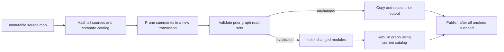

# Persistent module summaries and selective graph replay

This experimental API preserves the output of ContextProof's bounded static
resolver. A reused unknown graph remains unknown. It does not certify Python
behavior or the usefulness of context for an agent.

## State and execution

`GraphSession` owns fixed anchors and graph limits, source hashes, prior graphs,
their consulted-file sets, and a current-version module-summary cache.
`ModuleCache` keys summaries by `(source path, SHA256(source))`. Each summary
contains the parsed AST, guarded bindings, declarations and wildcard state.
Parse failures also have a summary. Binding dictionaries and lists are frozen;
AST objects are private and used read-only, not deeply immutable Python objects.
Neither graph outputs nor `index_stats` expose the cache.

An update copies the supplied mapping and validates paths and text. A new cache
transaction keeps only summaries matching current hashes. A fresh corpus catalog
is assembled whenever any graph needs rebuilding; import resolution is never
stored in a source-local summary. Unchanged summaries avoid parsing, binding
indexing and source-local guard work. Cross-file resolution still uses current
module candidates and records all consulted paths, including unsuccessful package
attribute checks before a submodule fallback. These reads must be recorded again
when a new graph is built from previously cached summaries.

Graph reuse copies the prior output, changes snapshot provenance and reseals it.
Catalog additions/removals conservatively invalidate selective reuse. For a stable
catalog, any changed consulted source triggers reconstruction. The strict default
also rejects reuse of graphs with a frontier; the experimental selective mode
preserves frontiers. Only after all anchors succeed are new summaries, graphs and
read sets published. A failed update leaves the previous committed session usable.
Even an update that reuses every graph prunes outdated summaries for unread files.

## Fair alternatives

| Mode | Indexing | Graph reuse |
|---|---|---|
| `warm_ast_rebuild` | cached AST, rebuild bindings per snapshot | none |
| `whole_corpus_guard` | same | only equal complete source maps |
| `read_set_any_status` | same | unchanged consulted files and catalog |
| `incremental_index_rebuild` | persistent guarded module summaries | none |
| `incremental_whole_corpus_guard` | same summaries | only equal complete source maps |
| `incremental_read_set` | same summaries | unchanged consulted files and catalog |

All methods share one indexed corpus among anchors of a snapshot. The combined
whole-corpus/incremental method is the heldout study's primary comparator because
it avoids graph reconstruction on source-identical revisions too. The original
`read_set_certificate` remains the public default and retains its completeness gate.

## Cost and correctness boundary

Every update hashes all supplied source bytes and checks the complete path set.
There is no claim of sublinear source ingestion. If a graph is rebuilt, creating
the catalog visits all current modules; only changed modules incur parsing,
binding indexing and guard work. Read-set checks scale with recorded consultations;
graph copies and reconstruction scale with their bounded outputs. Archive decoding
and checksum validation are included in study timings, so avoiding indexing cannot
eliminate those costs. Cache storage tracks current summaries and graph outputs,
not the number of prior versions; updates can temporarily keep old and candidate
state alive. Measured RSS includes the interpreter and source maps, not just caches.

The conditional argument is the usual dependency-tracking argument: if all inputs
that the deterministic resolver consults are unchanged, and its policy/catalog
are unchanged, its canonical result is unchanged except for refreshed snapshot
identity. Correct registration of every consultation is a premise, not a theorem
about arbitrary Python. Dynamic dispatch, generated code and unsupported bindings
remain explicit limitations. Fresh reconstruction with the same resolver is a
replay oracle, not an independent semantic oracle.

## Walkthrough and validation

1. `src/contextproof/reuse.py`: `GraphSession.update`, invalidation, defensive
   copies and atomic state publication.
2. `src/contextproof/module_cache.py`: summary containers, current-version pruning
   and work counters.
3. `src/contextproof/dependencies.py`: `_Corpus.from_texts` and recorded lookups.
4. `src/contextproof/static_scope.py`: source-local ambiguity guards.
5. `tests/test_incremental_module_cache.py`: negative dependencies after a cache
   hit, wildcard flags, path collisions, parse failures, truncation, rollback,
   output isolation and old-AST reclamation across twenty edits.
6. `scripts/run_incremental_holdout.py`: fresh per-snapshot uncached references,
   paired timing, separate RSS/tracemalloc children and complete-grid validation.

The counters describe actual indexing work in the last committed update, outside
the sealed graph artifact. If every graph is reused, indexing counters are zero;
the retained-summary count can still be nonzero. Use these counters to inspect
mechanism behavior, and use the raw experimental records for performance claims.

The current cache is process-local and not thread-safe. It accepts no serialized
external certificate. Callers must supply a consistent snapshot; passing a live
directory's mixed-time contents cannot provide atomic repository semantics.

[中文](../zh/INCREMENTAL_DESIGN.md) · [Research API](SELECTIVE_REUSE.md)
