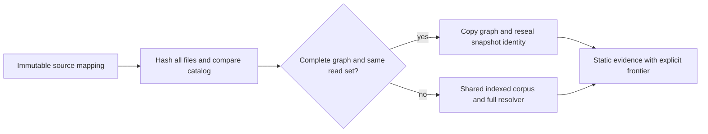

# Selective reuse of bounded source evidence

This is a research software experiment, not a mature-paper or production-safety
claim. It asks whether cached static evidence can be retained across repository
revisions without changing the output of the same bounded resolver.

## What is implemented

`contextproof.reuse.GraphSession` captures one graph per fixed anchor, records
consulted source files, and advances across immutable source mappings. Its three
modes are `warm_ast_rebuild`, `whole_corpus_guard`, and `read_set_certificate`.
All share one indexed corpus within a revision and a process-local AST cache
across revisions. The returned graphs are defensive copies.

A selective certificate is usable only when the old graph has no unresolved or
truncated frontier, the entire source-path catalog agrees, and every consulted
file is byte-identical. Otherwise the graph is rebuilt. The read set includes
anchor files, graph-node files, import-binding files, and candidate modules
examined during name lookup—even candidates that supplied no attribute.



`examples/selective_reuse.py` executes this path without executing analyzed code.

```bash
python -m pip install -e '.[dev]'
python examples/selective_reuse.py
python -m pytest -q
python scripts/check_attribution.py
python scripts/run_selective_reuse.py prepare
python scripts/run_selective_reuse.py run --suite all
python scripts/run_selective_reuse.py analyze --output PATH_TO_NEW_RUN_JSON
```

Preparation requires GitHub CLI read access and public archive downloads. Later
runs use local archives and no network. Defaults store downloads under ignored
`work/selective-reuse/archives`. Each run receives a unique output name; explicit
existing output paths are rejected. The benchmark CLI help is bilingual.

## Why visible graph nodes alone are insufficient

A qualified import can examine `pkg/__init__.py`, find no matching attribute,
and resolve a child module. That package file need not become a graph node.
Adding `__getattr__`, a wildcard import, or a competing binding changes static
resolution without changing any formerly visible target. The resolver therefore
records consulted candidates, and catalog additions conservatively invalidate
reuse. Tests cover negative lookups, nested packages, `.pyi` ambiguity, source
roots, additions, renames, input mutation and incomplete graphs.

## Conditional correctness argument

Assume a fixed Python parser, resolver version, graph policy, anchors, trusted
process-local cache, consistent source mapping, and collision-resistant hashes.
Assume every source-content read that can affect the bounded resolution is
registered. With the catalog and all registered contents unchanged, each
previous lookup sees the same candidates and bindings. Induction over the
bounded graph expansion preserves nodes, edges, frontiers and source status.
Only the snapshot identifier and integrity seal change. Catalog changes,
read-set changes and incomplete captures fall back to a rebuild.

This is the usual dependency-trace argument from incremental computation, not a
new theorem or a proof that dependency tracking covers arbitrary Python effects.
A canonical full-rebuild comparison tests implementation consistency. It does
not independently prove semantic equivalence, code relevance, or task success.
Resource exhaustion and hostile modification of the process are outside this
argument. No external serialized certificate is trusted.

## Independent scoped checks

The development corpus contains 72 instances from 24 syntax templates in six
families. Numeric variants are dependent observations. The 63 instances inside
the stated static contract include 12 old false-fresh decisions, all from four
class-global templates. Resolver 3 removes those 12; the remaining contract
labels agree. Nine runtime-effect cases remain outside the guarantee and are
reported separately, not silently promoted to safe reuse.

Resolver 3 was the implementation for those historical checks. The current
resolver is 4, which also conservatively guards deferred function-global writes
and class-private binding names; see [design and development evidence](FUNCTION_GLOBAL_BINDINGS.md).
Recapture older graph policies before current comparisons. Original measurements
and resolver-2/3 artifacts remain historical records, not current certificates.

## Exploratory preservation of unknown results

After the primary experiment returned zero natural eligibility, the separate
`read_set_any_status` ablation removes only the complete-graph gate. It applies
the same read-set/catalog guard and retains all unknown, missing and truncated
statuses. It is graph memoization, not a fresh-evidence declaration. The original
three-mode primary experiment and its negative conclusion are unchanged.

```python
session = GraphSession(anchors, mode="read_set_any_status")
result = session.update(current_source_mapping, snapshot_id)
# Inspect graph frontiers; reuse counts do not imply freshness.
```

See the [separate protocol](../../benchmarks/selective_reuse/ablation-protocol.json).
The ablation uses the same data and is exploratory, not independent confirmation.

## Costs and limits

Every update still hashes all supplied source text. Catalog checks are coarse;
a new unrelated path invalidates all selective certificates. Whole-file read
sets also rebuild on unrelated edits within a consulted file. An incomplete
graph is always rebuilt in selective mode, even when whole-corpus equality could
safely retain its *unknown* status. The simpler whole-corpus baseline exposes
this disadvantage. This experiment does not introduce a hybrid policy after
seeing the results.

Initial capture, loading, hashing, cloning, sealing, fallback and repeated costs
are distinguished in raw data. The benchmark measures a warm OS file cache and
source archive reading, not network latency or full process startup. It does not
measure GPU kernels, model token savings, or coding-agent effectiveness.

See [study report](RESEARCH_REPORT.md), [protocol](../../benchmarks/selective_reuse/protocol.json),
[source pins](../../benchmarks/selective_reuse/natural-manifest.json),
[oracle matrix](../../benchmarks/selective_reuse/results/v2-v3-matrix.json),
and [third-party provenance](../../third_party/README.md).
