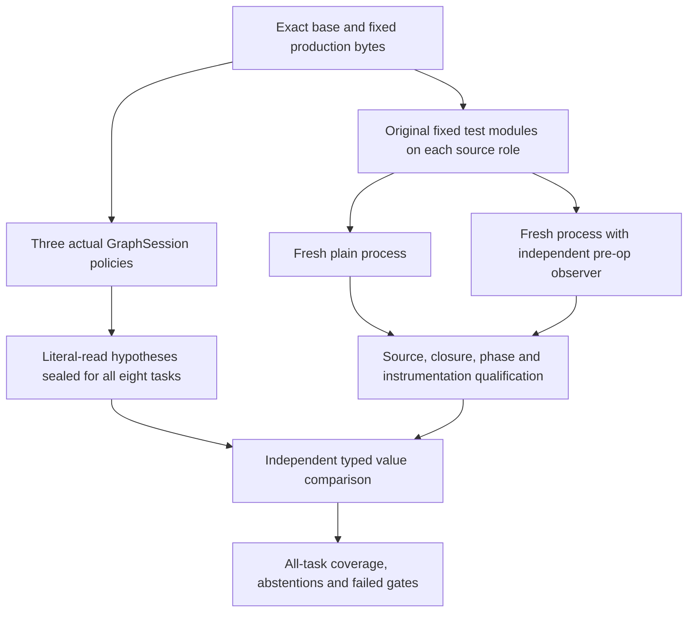

# Independent pre-op binding observations — 2026-10-15

The frozen eight-task experiment is complete. **The finite-utility gate failed.**
Current-source rebuilding, whole-corpus reuse and selective read-set reuse produced
identical graph and value-hypothesis outputs on all eight tasks. There is no observed
quality improvement over the strong baselines.

This stage adds independently measured runtime evidence, not a new resolver algorithm.
It is a prospective within-study convenience panel: task content was withheld from
method implementation until source/protocol freeze. “Unseen” refers only to the
recorded research-exposure inventory. No model-pretraining or population claim follows.
The work remains experimental; full semantic freshness, necessary context, coding-agent
benefit, external reproduction and research maturity are unestablished.

[中文](../zh/SEMANTIC_OBSERVER.md) ·
[Frozen protocol](../../benchmarks/semantic_observer/PROTOCOL.md) ·
[Generated results](../../benchmarks/semantic_observer/results/prospective8-20261015/REPORT.md) ·
[Raw index](../../benchmarks/semantic_observer/results/prospective8-20261015/INDEX.json) ·
[Input reconstruction](../../benchmarks/semantic_observer/inputs/prospective8-20261015/REPRODUCING.md)

## Actual execution and negative results

All 32 original conditions closed: eight tasks × two source roles × plain/observed.
After a user-requested pause, 21 already closed conditions were reused and only the
missing 11 ran. An independent before/after inventory found all 875 retained files
unchanged. Predictions were not recomputed and the frozen protocol was not modified.

All 16 plain/observed pairs have equal selected items, phase outcomes and exit codes.
All 16 observer reports are intact/complete, with zero dropped events. The strict
frozen phase-completion gate nevertheless rejects two tasks: the original tests emit
multiple call reports for subtests, while the frozen adapter expects one call phase
per selected item. Both failures remain in the eight-task denominator.

| Quantity | Actual result | Interpretation |
|---|---:|---|
| Execution/observer/prediction-qualified tasks | 6/8 | Includes tasks with no supported primitive sites |
| Tasks with scoreable primitive sites in both roles | 3/8 | eval-01, eval-06, eval-08 |
| Tasks with at least one accepted site | 2/8 | Required at least 4/8; failed |
| Qualified primitive site/source-role observations | 38 | Includes unselected/refused sites |
| Accepted site/source-role observations | 28 | All 28 agree, across only two tasks |
| Accepted primitive events | 1426 | Repeated executions are not independent samples |
| All-eight task-macro site coverage | 5/24 = 20.8333% | Invalid/zero denominators contribute zero |
| Whole graphs without a frontier, first static repeat | 12/420 | Separate from individual value hypotheses |
| Main finite-utility gate | Failed | Required 8/8 qualification and 4/8 accepting tasks |

The 28 accepted observations are pooled across before/after source roles. They are not
28 independent tasks or a general semantic accuracy estimate. Their supporting graphs
all have unresolved frontiers. Always-abstain accepts zero sites and has undefined
conditional accuracy. All three nontrivial methods tie, including every retained
static repetition; three repetitions do not triple the dataset.

The observer retained 128234 LOAD_GLOBAL events: 2653 supported primitive, 42814 builtin
fallback and 82767 unsupported-value events. Raw primitive site/source-role count is
56; 18 sites/1211 events belong to an execution-unqualified task and remain diagnostics.
Only 38 sites/1442 events enter the qualified primitive pool. Unsupported values are
not silently counted as correct. eval-02 and eval-03 execute production global loads
but observe no supported primitive bindings; eval-05 observes no LOAD_GLOBAL at all.

The subtest failures are an adapter limitation, not a demonstrated difference between
plain and observed assertions. eval-04 selects 49 items and emits 58 call reports;
eval-07 selects 66 and emits 97. The original reports, including mixed subtest failures,
are retained in order. No after-the-fact phase-rule relaxation is used.

## What is actually measured

The observer does not import the resolver. It pins production Python bytes, compiles
those bytes without executing them, and certifies runtime code signatures/filenames
against that compilation. It observes the binding before a CPython3.12 LOAD_GLOBAL
instruction; this does not prove the operand was successfully consumed.

Exact None/bool/bounded-int/finite-float values are typed. Strings and bytes retain only
lengths and SHA256. User repr, equality and arbitrary attributes are not invoked by the
codec. Builtins, missing bindings, non-exact primitive subclasses, unsupported objects,
uncertified code, partial locations and truncation remain distinct states.



Graph policies use separate equally configured persistent module caches. Currentfresh
rebuilds with current module summaries; it is not an intentionally cold full-reparse
control. Up to 32 statically chosen function identities per task come from the union
of production snapshots, ordered by path/name SHA256. Selection never uses traces,
acceptance or task outcomes. Depth is 4, nodes 256, repetitions 3, method order rotated,
no warmup. End-to-end preparation/capture/replay/projection costs are retained. Timing
is descriptive; this study does not claim an execution or cache speedup.

The static side generates **experimental runtime-value hypotheses from resolved literal
read edges**. The product's source-identity witness does not promise immutable runtime
values. A disagreement would refute this derived hypothesis, not automatically establish
a stale whole-graph certificate or a product bug. Strict matching uses path, source SHA,
runtime qualified owner and name, plus unique function-span containment. It is not
occurrence-exact static-edge reconstruction; true opcode sites remain separate.

## Sources, versions and licensing

The [public provenance](../../benchmarks/semantic_observer/results/prospective8-20261015/provenance.json)
contains official task URLs, full base/fix/test hashes, selection and exposure checks,
configuration deviations and legal provenance. The source implementation was committed
as `d3c7c8c7a0e622419f3c3350f38678127fbf8620` before task-content unsealing.
All 33 implementation/protocol source bindings are checked for each condition.

| Task | Official developer fix | Original full changed test module |
|---|---|---|
| eval-01 | [platformdirs #614](https://github.com/tox-dev/platformdirs/pull/614) | tests/test_unix.py |
| eval-02 | [platformdirs #612](https://github.com/tox-dev/platformdirs/pull/612) | tests/test_macos.py |
| eval-03 | [cachetools #441](https://github.com/tkem/cachetools/pull/441) | tests/test_ttl.py |
| eval-04 | [cachetools #436](https://github.com/tkem/cachetools/pull/436) | tests/test_cachedmethod.py |
| eval-05 | [python-slugify #194](https://github.com/un33k/python-slugify/pull/194) | test_add_uppercase_error.py |
| eval-06 | [python-slugify #148](https://github.com/un33k/python-slugify/pull/148) | test.py |
| eval-07 | [mistune #487](https://github.com/lepture/mistune/pull/487) | tests/test_renderers.py |
| eval-08 | [mistune #478](https://github.com/lepture/mistune/pull/478) | tests/test_security_footnotes.py |

These are original developer fixes, not generated repairs. The base production role
receives the exact fixed original test/fixture overlay; the fixed role uses fixed
production and the same tests. Original parametrization/subtests are retained. Upstream
source/test bodies and wheels are not redistributed. Actual upstream MIT/BSD-3-Clause
and dependency license/NOTICE bytes remain in the [input assets](../../benchmarks/semantic_observer/inputs/prospective8-20261015/).
The project's MIT license does not replace those licenses. Four actual version metadata
files were generated by the declared original VCS build backend; their outputs/proofs
are retained separately from original source. They are not hand-written substitutes.

Runtime basis: [CPython3.12 tracing](https://docs.python.org/3.12/library/sys.html#sys.settrace)
and [LOAD_GLOBAL](https://docs.python.org/3.12/library/dis.html#opcode-LOAD_GLOBAL).
No strict clean-room, academic firstness or upstream-platform reproduction is claimed.

## Recompute the retained evidence offline

Run from the research checkout with Python3.11+ for the offline report. Actual observation
requires CPython3.12. Reference host: Apple M1 Pro ARM64, 16GiB, CPython3.12.2, no GPU.

```sh
python -m pip install -e '.[dev]'
python -m benchmarks.semantic_observer.report \
  --bundle benchmarks/semantic_observer/results/prospective8-20261015 \
  --expected-index-sha256 b0c354cf756bc700f14a8cfdfa0695b2d671305bd0715574b426e769f9dc8328 --check
python -m pytest -q tests/test_semantic_observer.py tests/test_semantic_observer_independent.py tests/test_semantic_methods.py tests/test_semantic_predict.py tests/test_semantic_runner.py tests/test_semantic_score.py tests/test_semantic_report.py
```

INDEX pins every published raw JSON byte; the report checks exact file membership,
recomputes closures/parity, loads only retained SHA-checked scoring bytes and produces
matching English/Chinese reports. This is a record check, not a new upstream execution
or an external replication. Full phase events, encoded observations, all four methods,
three static repetitions, frontiers, failures and timings remain in task-000..007.json.
Only static graph anchor source bodies and private command/environment paths were
removed in the public projection; original artifact SHA commitments remain.

## Walkthrough and extension boundaries

Read observer.py (code certification and typed binding records), methods.py (actual
policies and literal hypothesis projection), predict.py (all-task seal), worker.py
(original-test execution), run.py (closure/parity/resource qualification), score.py
(independent value alignment), then report.py (hash-checked recomputation).
GlobalReadObserver is single-use; report() follows context exit. evaluate_pair receives
both production snapshots, never test outcomes. score_pair receives both roles and
explicit parity validity. Public help/docstrings provide English/Chinese explanations.

Source compilation and code signatures are bounded, but this is not an OS sandbox.
Native code, synthetic/unpinned filenames, signals, transient threads, hostile tracing,
source changes restored between checks, mutable objects, module/class LOAD_NAME,
attributes and locals are outside the primitive-global endpoint. Graph methods require
UTF-8 source. A pre-op event is not necessary coding context or full program behavior.

Two exposed yt-dlp calibration tasks and all eight earlier conditions remain separate:
all four role pairs have equal outcomes but fail process qualification due a dependency
architecture probe. Their diagnostic zero acceptance is retained, not promoted to
holdout. Earlier bootstrap/metadata/projection/qualification failures are preserved.
The old untracked calibration execution source was reconstructed later and accepted
only on exact matches to its previously recorded SHA; it is not a fabricated past commit.

Next research work must treat these eight tasks as exposed development data. Better
subtest event accounting or broader value hypotheses need a new declared development
stage and a newly frozen cohort. Independent necessary-context labels, meaningful task
utility, generalization and external scrutiny remain the evidence gaps. No Release,
production-readiness, SOTA or mature-paper claim follows from this experiment.

## Reconstruct inputs and rerun the exposed fixed panel

Use a reviewed checkout and CPython3.12.2. A different3.12 patch must be explicitly
recorded with `--allow-runtime-deviation`; it is not the measured reference environment.
The preparer uses normal TLS, fixed official archives and hash-locked legal wheels.
Its `--check-spec` mode is entirely offline. `--cache-directory` and `--offline` allow
exact already-downloaded bytes to be reused. Existing outputs are never overwritten.

```sh
python -m benchmarks.semantic_observer.prepare \
  --spec benchmarks/semantic_observer/inputs/prospective8-20261015/spec.json \
  --expected-spec-sha256 af1ca2c413cde8dfac13ce216943603934574c4b9c7ea6f91eaa37ef38d5f265 \
  --expected-index-sha256 0ab9b99349c561e7822aa3785f1b5d674d72bfa4c6f9fc89bdc1d11a753ed363 --check-spec

ACE_WORK="$(mktemp -d)"
export ACE_WORK
python -m benchmarks.semantic_observer.prepare \
  --spec benchmarks/semantic_observer/inputs/prospective8-20261015/spec.json \
  --expected-spec-sha256 af1ca2c413cde8dfac13ce216943603934574c4b9c7ea6f91eaa37ef38d5f265 \
  --expected-index-sha256 0ab9b99349c561e7822aa3785f1b5d674d72bfa4c6f9fc89bdc1d11a753ed363 \
  --output "$ACE_WORK/prepared"
PYTHONPATH=src python - <<'PY'
from pathlib import Path
import json
import os
from benchmarks.semantic_observer.predict import predict
from benchmarks.semantic_observer.run import run
root = Path.cwd().resolve()
work = Path(os.environ['ACE_WORK']).resolve()
manifest = json.loads((work / 'prepared/runner-manifest.json').read_bytes())
protocol = json.loads((root / 'benchmarks/semantic_observer/protocol-v1.json').read_bytes())
predict(manifest, protocol, work / 'predictions', repository=root)
run(manifest, protocol, work / 'execution', repository=root, predictions=work / 'predictions')
PY
```

The same APIs produced the retained primary predictions and conditions. A fresh
reference-environment offline preparation was also actually run: fifteen exact wheels
installed in a new venv, pip check passed, sixteen reconstructed source roles matched
all pinned bytes, and the runtime showed no reference-identity deviation. This input
check did not add new SUT outcomes. Fresh networking through this new preparer was not
retested; the declared official artifacts were previously acquired and verified.
A rerun now uses exposed tasks and must stay separate from the primary record.
