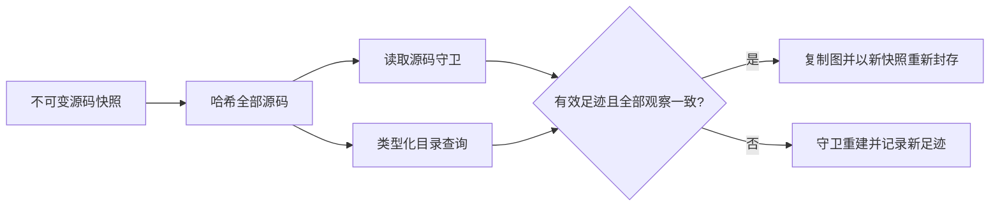

# 目录查询实验协议

本研究检验进程内静态图的增量复用机制。[机器可读协议](../../benchmarks/catalog_reuse/protocol.json)
定义冻结的测量方法与目标；记录的协议提交先于自然版本解析与计时。这是本地协议冻结，
不是公开预注册，也不是成熟研究验收。

## 机制与强对照

A=`incremental_read_set`，守卫全部路径目录与读取源码哈希。B只允许具有有效足迹的
零目录查询图免于目录失效。C守卫全部实际查询模块根的完整成员。D记录完整有序候选
路径元组（包含空结果）和命名空间存在性布尔值（包含false）。**主对照是D与C**。
四者共用模块摘要缓存、固定锚点、depth4/node256策略、全输入源码哈希；unknown与
truncated不升级。相关查询或读取源码改变、足迹缺失或版本不支持时重建；不接收外部证书。

[条件性论证](CATALOG_SOUNDNESS.md)列明所有读取被捕获等前提，不证明反射、动态派发
或Python运行时导入语义。实验模式位于`contextproof.reuse.GraphSession`，不同于产品的
持久化`graph_session.GraphSession`，不能据此声称CLI端到端或agent加速。



目录索引覆盖合格路径及点分祖先；每次仍读取、哈希全部源码。守卫成本取决于读取文件
与查询数量，比较候选元组还计入其长度；根守卫可能比较整包。图复制及seal仍随图载荷
增长，精细失效不能消除这些固定成本。

`PYTHONPATH=src python examples/catalog_reuse.py`以小规模合成输入运行四个真实模式。
在查询根内新增无关文件仅D复用；加入同名stub碰撞后四模式均重建。示例核对fresh
canonical字节，属于机制演示，不是自然实验证据。

## 结果前的输入选择

选定RQ、MCP Python SDK、Scrapy、Hatch四个领域。分别固定执行时HEAD与128条first-parent
转移；使用真实提交pin，不称稳定版本。主轨迹取祖先距离128、120、…、8、0的17快照，
形成16次源码更新，每次批量覆盖8条转移。同一窗口全部23个目录变化的直接父→子事件对
作为机制解释面板；条件化面板不能代表普通变化成本。

在最旧主快照列举直接module.body函数的唯一path:symbol键，按SHA256(path+冒号+symbol)、
再按identity排序，取24项。重复声明保持歧义；后续缺失保持缺失，不重新选取。冻结前已读
AST结构元数据，故仅对候选解析和计时结果前瞻，不称完全未见源码留出或代表性总体。
MCP SDK也是本项目可选集成依赖，明确披露该关系。

[选样记录](../../benchmarks/catalog_reuse/selection.json)保留20候选实时元数据及17个历史
预检。最初稳定发布+8转移缺乏事件；128转移内最近8目录事件规则在17库中完整可行集为0。
在解析/性能结果前改为等距主轨迹加**全部**事件。选定历史有512转移、864条原始增删路径：
711非Python、107在prefix外、46条纳入生产路径，涉及23次转移。排除顺序先检查prefix再检查
测试/缓存，因此后一类为0不代表无测试路径。旧预检“path events”实际单位为转移，非路径条数。

## 验证、计时和资源门槛

主正确性硬门是缓存图与同解析器fresh构建canonical字节零差异。另用未修改的
`ce6e36de7f6860296d66dadcb3105a8bbda9eb9a`解析器检查全部107独立源码快照，以捕获双方
共享目录重构错误。两种oracle均不证明Python语义。人工编写的反例属于开发回归，不是独立
自然任务或人工评审gold。

每方法/库一次完整预热、五次测量轨迹，轮换整个方法顺序；每轨迹新建会话。计入本地归档
读取/哈希/解压、生产源码筛选/解码/哈希、初始锚点捕获，以及会话的所有复制/守卫/重建/reseal。
不计网络、元数据解析、oracle、结果序列化。分别报告初始捕获、16次回放总和与捕获+回放；
这是暖文件系统下冷会话，不是整机冷启动。性能实验不并发争抢资源。

预先目标：D相对C的回放中位耗时下降>=20%，至少3/4库，且零差异。每方法/库另外运行三次
fresh RSS子进程，内存目标<=1GiB且<=C的2倍。目标不能写成实测；不进行显著性检验或普遍
加速推断。保留所有重复、方法、负面和失败；库、批次、锚点及重复之间存在依赖。

## 复现

安装本研究分支：`python -m pip install -e '.[dev]'`。下载到任何Git树之外，然后运行：

```sh
python scripts/prepare_catalog_sources.py --output /tmp/catalog-study-inputs
PYTHONPATH=src python scripts/run_catalog_study.py \
  --inputs /tmp/catalog-study-inputs/ready-manifest.json \
  --protocol benchmarks/catalog_reuse/protocol.json \
  --output /tmp/catalog-study-results
```

归档与上游许可证保留在仓库之外；公开材料仅含元数据、哈希和结果摘要，不分发上游源码包、
源码片段、凭据或私人日志。[原始结果](../../benchmarks/catalog_reuse/results/)和生成报告只在
真实执行后加入；不存在结果不算通过。不需要GPU、模型或商业API。
