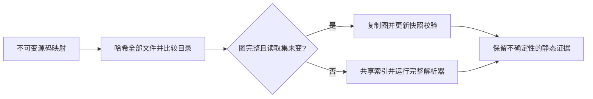

# 有界源码证据的选择性复用

这是研究软件实验，尚不代表成熟论文或生产安全认证。问题是：跨仓库版本
复用静态证据，能否保持同一个有界解析器的完整输出，同时节省实际开销？

## 已实现机制

`contextproof.reuse.GraphSession` 固定锚点和策略，在不可变源码映射上推进。
三种模式为 `warm_ast_rebuild`、`whole_corpus_guard`、`read_set_certificate`。
三者都在同一版本共享已建索引的语料，并跨版本共享进程内 AST 缓存，避免
给基线人为增加逐锚点重复建索引的负担。返回的图经过防御性复制。

选择性证书仅在旧图没有未解析或截断前沿、完整路径目录不变、读取集内
所有文件字节不变时可用；否则重建。读取集包含锚点、节点、导入绑定文件，
还包含名称查找曾检查却没有返回目标属性的候选模块文件。



```bash
python -m pip install -e '.[dev]'
python examples/selective_reuse.py
python -m pytest -q
python scripts/check_attribution.py
python scripts/run_selective_reuse.py prepare
python scripts/run_selective_reuse.py run --suite all
python scripts/run_selective_reuse.py analyze --output PATH_TO_NEW_RUN_JSON
```

准备数据需要 GitHub CLI 的读取能力及公开源码下载；下载完成后实验离线运行，
不执行被分析的上游代码。默认缓存位于忽略的 `work/selective-reuse/archives`。
每次实验产生唯一文件，指定已有输出路径会拒绝覆盖；CLI 帮助为双语。

## 为什么不能只看图中的文件

导入查找可能检查 `pkg/__init__.py`，没有找到属性后回退到子模块；包文件
却没有成为可见图节点。后来增加 `__getattr__`、通配导入或同名绑定，就会
改变静态解析。实现因此记录所有咨询过的候选模块，并对目录变化保守失效。
测试覆盖多层负查找、`.pyi` 歧义、源码根目录、新增、重命名、输入/输出修改
以及不完整图。

## 有条件的正确性论证

假设 Python 解析器、解析器版本、策略、锚点固定；进程内缓存可信，源码映射
一致，哈希没有碰撞；所有影响有界解析的源码读取都已登记。当路径目录和
这些输入保持不变，每次查找看到相同候选及绑定，沿有界图展开可归纳得到
相同节点、边、前沿及来源状态，只更新快照标识与完整性校验。其余情况重建。

这是增量计算中的已有依赖追踪论证，不是新定理，也不证明已捕获任意 Python
副作用。与完整重建逐字节比较仅检验实现一致性，不能替代语义等价、上下文
相关性或任务成功的独立验证。资源耗尽和进程被恶意修改不在此论证内。
实现不接受外部序列化证书作为可信依据。

## 独立的有界验证

开发语料包含六个家族、24 个语法模板、72 个实例。数字变体相互关联，不能
当作 72 项独立研究。63 个契约内实例中，旧版有 12 个 false-fresh，均来自
四个 class-global 模板；解析器 3 修复了这 12 个，其余契约标签也一致。
另外九个运行时副作用压力例仍在保证范围外，明确单列，不伪装成安全复用。

解析器 3 拒绝旧图版本，比较前必须重新捕获基线。历史实验和解析器 2 制品
保留，不用新结果覆盖旧记录。

## 探索性保留 unknown 结果

主实验自然覆盖为零后，单独的 `read_set_any_status` 消融只取消完整图门槛，
继续检查相同读取集和目录，并完整保留 unknown、missing、truncated 状态。
这是图输出缓存，不是 fresh 证据认证。原三模式主实验及否定结论不变。

```python
session = GraphSession(anchors, mode="read_set_any_status")
result = session.update(current_source_mapping, snapshot_id)
# 必须继续检查图的 frontier；复用次数不是 freshness。
```

[独立消融协议](../../benchmarks/selective_reuse/ablation-protocol.json) 使用同一
数据，仅为探索性结果，不是独立确认或留出评估。

## 成本与边界

每次更新仍哈希全部输入。目录策略较保守，新增无关文件也触发重建；读取
文件内部的无关编辑也会使整文件证书失效。选择性模式遇到不完整图总是
重建，即使全语料相同本可安全保留其 unknown 状态。简单全语料基线会暴露
这项代价，本实验不会看到结果后暗换成混合策略。

原始数据分开初次捕获、加载、哈希、复制、校验、回退和重复开销。测量包括
暖操作系统缓存下的源码归档读取，不含网络下载，也不是完整进程冷启动。
未测 GPU、模型 token 节省或代码 Agent 任务效果。

参见[研究报告](RESEARCH_REPORT.md)、[冻结协议](../../benchmarks/selective_reuse/protocol.json)、
[源码版本清单](../../benchmarks/selective_reuse/natural-manifest.json)、
[反例矩阵](../../benchmarks/selective_reuse/results/v2-v3-matrix.json)和
[第三方归属](../../third_party/README.md)。
