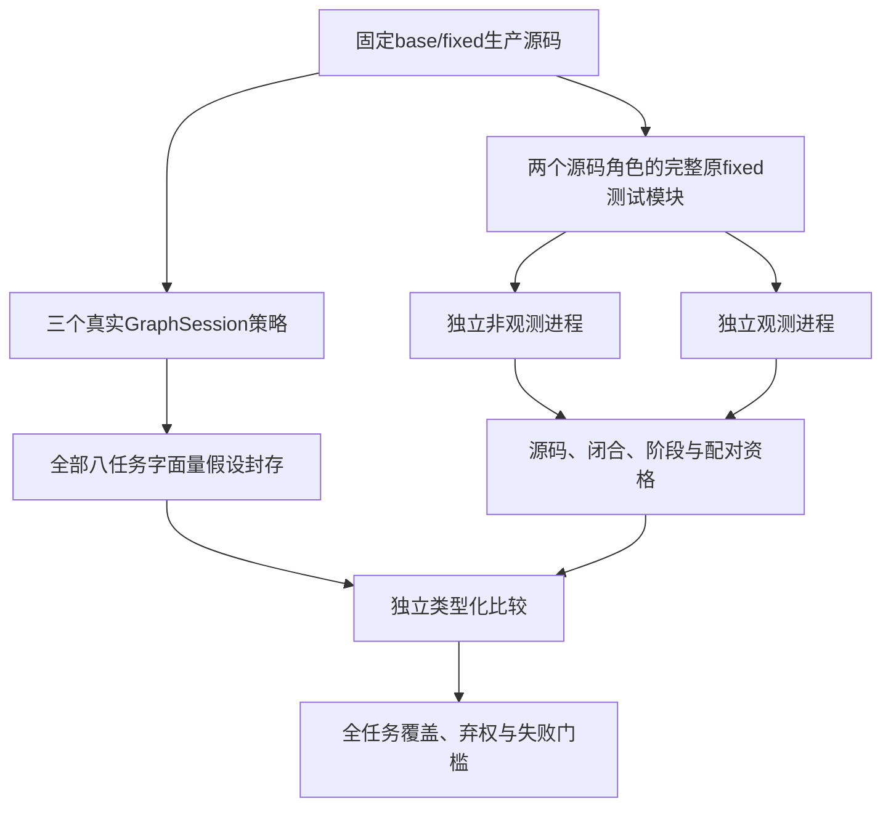

# 独立执行前绑定观测——2026-10-15

固定八任务实验已运行完成，**有限效用主门槛未通过**。当前源码重建、整库相等复用、
选择性读取集复用在全部八任务上给出相同图与值假设，没有观察到相对强基线的质量提升。

本阶段增加独立运行测量，不是新增解析算法。任务内容在实现与协议冻结后才解封；
“未见”仅相对于已记录的研究暴露库存，不代表模型预训练未见或总体代表性。
项目仍为实验研究，完整语义fresh、必要上下文、智能体收益、外部独立复现与成熟度尚未建立。

[English](../en/SEMANTIC_OBSERVER.md) ·
[固定协议](../../benchmarks/semantic_observer/PROTOCOL_zh.md) ·
[自动结果表](../../benchmarks/semantic_observer/results/prospective8-20261015/REPORT_zh.md) ·
[原始索引](../../benchmarks/semantic_observer/results/prospective8-20261015/INDEX.json) ·
[输入重建](../../benchmarks/semantic_observer/inputs/prospective8-20261015/REPRODUCING.md)

## 实际执行与负面结果

八任务×两源码角色×开启/关闭观测，共32条件全部闭合。用户暂停换模型后，复用21条件，
仅补跑缺少的11条件；独立前后库存确认原875文件字节完全未变。没有重算预测或修改冻结协议。

16组的选中项、逐阶段结果、退出码均相同；16份观测报告完整有效、零丢弃。
但原子测试产生同一选中项的多次call报告，冻结适配器只接受单call阶段，因此两任务被
严格阶段门槛拒绝，仍保留在八任务分母中。

| 项目 | 实测 | 含义 |
|---|---:|---|
| 执行/观测/预测合格任务 | 6/8 | 包含没有受支持primitive站点的任务 |
| 两角色均有可计分primitive站点 | 3/8 | eval-01、eval-06、eval-08 |
| 至少一个接受站点的任务 | 2/8 | 预设至少4/8，未达到 |
| 合格primitive站点×源码角色观测 | 38 | 包含未选owner和拒绝项 |
| 接受的站点×源码角色观测 | 28 | 28项全部一致，但仅来自两任务 |
| 接受primitive事件 | 1426 | 重复执行不等于独立样本 |
| 全八任务宏平均站点覆盖 | 5/24＝20.8333% | 无资格/零分母贡献零 |
| 首次静态重复中无frontier整图 | 12/420 | 与单绑定假设分开统计 |
| 有限效用主门槛 | 未通过 | 要求8/8资格及4/8任务有接受 |

28项合并了before/after源码角色，不是28个独立任务，不能当广义语义准确率；
支撑这些接受项的图仍都有未解析frontier。always-abstain接受零项，条件准确率未定义。
三个非平凡方法在全部任务、全部静态重复中平局；三次重复不增加任务数。

共保留128234次LOAD_GLOBAL：2653受支持primitive、42814内置回退、82767不支持值。
原始primitive站点×源码角色有56项；不合格任务的18站点/1211事件只作诊断，
合格primitive池为38站点/1442事件。不支持值不计作正确。
eval-02/03确实执行了生产代码全局读取，但没有受支持primitive值；eval-05完全没有LOAD_GLOBAL观测。

子测试失败反映适配器限制，不是开启/关闭观测器的断言差异：eval-04选49项却有58个call报告；
eval-07选66项却有97个call报告。包含混合失败的全部原报告按序保留，没有事后放宽阶段规则。

## 测量范围与设计

观测器不导入解析器。它固定生产Python字节，只编译而不执行这份字节，再用代码签名和文件名
认证运行时frame；在CPython3.12的LOAD_GLOBAL执行前记录绑定，不证明操作数已被成功消费。

精确None/bool/有界int/有限float按类型编码；字符串和bytes仅保存长度、SHA256。
编码不调用用户repr、相等比较或任意属性。内置名、缺失名、子类、不支持对象、未认证代码、
不完整位置及截断分别保留。



各方法独立同配置持久模块缓存；currentfresh使用当前模块摘要重建图，不刻意冷解析削弱基线。
两生产快照函数身份并集按路径/名称SHA排序，最多32个，不依据轨迹、接受与任务结果选择。
图深度4、节点256、重复3次、轮换顺序、无预热。加载、公共准备、capture/replay及投影成本
均保留；耗时只作描述，不据此声称执行或缓存加速。

静态侧从真实已解析字面量读取边生成**派生运行时值假设**。源码身份见证不承诺值不可变，
失配只能反驳这个派生假设，不能自动称整图stale或产品错误。
按路径、源码SHA、运行时限定owner与全局名精确匹配，并检查位置包含于唯一函数范围；
这不是静态读取occurrence精确重建，真实opcode站点仍分开保存。

## 来源、固定版本与许可

[公开来源记录](../../benchmarks/semantic_observer/results/prospective8-20261015/provenance.json)
包含官方任务链接、完整base/fix/test哈希、筛选与暴露审查、配置偏离和实际许可。
实现在解封任务内容前提交为`d3c7c8c7a0e622419f3c3350f38678127fbf8620`；每条件核验33项绑定。

| 任务 | 原开发者官方修复 | 完整原改动测试模块 |
|---|---|---|
| eval-01 | [platformdirs #614](https://github.com/tox-dev/platformdirs/pull/614) | tests/test_unix.py |
| eval-02 | [platformdirs #612](https://github.com/tox-dev/platformdirs/pull/612) | tests/test_macos.py |
| eval-03 | [cachetools #441](https://github.com/tkem/cachetools/pull/441) | tests/test_ttl.py |
| eval-04 | [cachetools #436](https://github.com/tkem/cachetools/pull/436) | tests/test_cachedmethod.py |
| eval-05 | [python-slugify #194](https://github.com/un33k/python-slugify/pull/194) | test_add_uppercase_error.py |
| eval-06 | [python-slugify #148](https://github.com/un33k/python-slugify/pull/148) | test.py |
| eval-07 | [mistune #487](https://github.com/lepture/mistune/pull/487) | tests/test_renderers.py |
| eval-08 | [mistune #478](https://github.com/lepture/mistune/pull/478) | tests/test_security_footnotes.py |

这些是已有开发者修复，不是生成修复。base生产源码覆盖同一份fixed原测试/fixture，fixed角色
使用修复源码和相同测试；原参数化/子测试不改写。源码、测试正文和wheel不重新分发。
原MIT/BSD-3-Clause及依赖LICENSE/NOTICE字节在[输入材料](../../benchmarks/semantic_observer/inputs/prospective8-20261015/)保留，
不统一改成项目MIT。四份版本元数据由原声明的VCS后端实际生成，原产物及证明单列，不是手写stub。

运行时依据：[CPython3.12 tracing](https://docs.python.org/3.12/library/sys.html#sys.settrace)、
[LOAD_GLOBAL](https://docs.python.org/3.12/library/dis.html#opcode-LOAD_GLOBAL)。
不声称严格clean-room、学术首创或完整复刻这些上游平台。

## 离线重算公开证据

在研究分支根目录运行。离线检查支持Python3.11+；实际观测仅支持CPython3.12。
参考硬件为Apple M1 Pro ARM64、16GiB、CPython3.12.2，不使用GPU。

```sh
python -m pip install -e '.[dev]'
python -m benchmarks.semantic_observer.report \
  --bundle benchmarks/semantic_observer/results/prospective8-20261015 \
  --expected-index-sha256 b0c354cf756bc700f14a8cfdfa0695b2d671305bd0715574b426e769f9dc8328 --check
python -m pytest -q tests/test_semantic_observer.py tests/test_semantic_observer_independent.py tests/test_semantic_methods.py tests/test_semantic_predict.py tests/test_semantic_runner.py tests/test_semantic_score.py tests/test_semantic_report.py
```

INDEX固定所有公开原始JSON字节；检查器核对文件集合，重算闭合/配对，只执行同份已核SHA的计分
源码，生成数字一致的中英文报告。这是记录检查，不是新上游运行或外部独立复现。
task-000..007.json保留全部阶段、编码观测、四方法、三次静态重复、图完整性及frontier汇总计数、
失败和耗时。公开投影省略整份图锚点明细行，包括逐锚点状态、frontier原因和可达节点明细，
以及私人命令/环境路径；保留原始产物SHA承诺，完整锚点明细仍在私下封存预测中。

## 代码阅读与边界

依次读observer.py（代码认证/编码观测）、methods.py（真实策略/假设）、predict.py（全任务封存）、
worker.py（原测试）、run.py（闭合/阶段/资源资格）、score.py（独立对齐）、report.py（重算）。
GlobalReadObserver只用一次，退出context后report()；evaluate_pair只收两生产快照；
score_pair接两角色观测和显式配对资格；帮助及关键接口说明中英双语。

编译/签名有上限，但不是操作系统沙箱。原生代码、合成/未固定文件名、信号、瞬时线程、主动
破坏跟踪、检查间修改再恢复源码、可变对象、模块/类LOAD_NAME、属性和局部变量，都在本端点外。
图方法要求UTF-8源码。执行前绑定不是必要编程上下文，也不是完整行为。

两个已暴露yt-dlp开发校准任务的8条件单列：4组结果相同，却因依赖架构探测触发进程拒绝而全部
不具完整资格，诊断零接受保留，不改称留出验证。早期bootstrap/元数据/投影/资格失败全部保存。
旧未提交校准源码后来按已记录SHA逐字节重建，明确不是历史提交或当时已归档。

下一阶段须把这八任务视为已暴露开发数据。改进子测试事件核算或扩展值假设，都需单独声明开发
阶段并冻结新样本；不能覆盖本次失败。独立必要上下文标签、实际任务效用、泛化及外部审查仍缺。
本实验不形成Release、生产就绪、SOTA或成熟论文结论。

## 重建输入并重跑已暴露固定面板

使用审阅过的源码checkout及CPython3.12.2；其他3.12补丁版须显式传
`--allow-runtime-deviation`记录偏离，不能称本次参考环境。
准备器仅用正常TLS、固定官方归档及完整hash锁定的合法wheel；`--check-spec`完全离线。
`--cache-directory`与`--offline`可以复用精确缓存，既有输出不覆盖。

```sh
python -m benchmarks.semantic_observer.prepare \
  --spec benchmarks/semantic_observer/inputs/prospective8-20261015/spec.json \
  --expected-spec-sha256 af1ca2c413cde8dfac13ce216943603934574c4b9c7ea6f91eaa37ef38d5f265 \
  --expected-index-sha256 0ab9b99349c561e7822aa3785f1b5d674d72bfa4c6f9fc89bdc1d11a753ed363 --check-spec

ACE_WORK="$(mktemp -d)"
export ACE_WORK
python -m benchmarks.semantic_observer.prepare \
  --spec benchmarks/semantic_observer/inputs/prospective8-20261015/spec.json \
  --expected-spec-sha256 af1ca2c413cde8dfac13ce216943603934574c4b9c7ea6f91eaa37ef38d5f265 \
  --expected-index-sha256 0ab9b99349c561e7822aa3785f1b5d674d72bfa4c6f9fc89bdc1d11a753ed363 \
  --output "$ACE_WORK/prepared"
PYTHONPATH=src python - <<'PY'
from pathlib import Path
import json
import os
from benchmarks.semantic_observer.predict import predict
from benchmarks.semantic_observer.run import run
root = Path.cwd().resolve()
work = Path(os.environ['ACE_WORK']).resolve()
manifest = json.loads((work / 'prepared/runner-manifest.json').read_bytes())
protocol = json.loads((root / 'benchmarks/semantic_observer/protocol-v1.json').read_bytes())
predict(manifest, protocol, work / 'predictions', repository=root)
run(manifest, protocol, work / 'execution', repository=root, predictions=work / 'predictions')
PY
```

原主实验实际使用相同API产生预测与条件。另已实际运行一次参考环境下的全新离线输入准备：
新venv安装15个精确wheel、pip check通过、16源码角色全部字节匹配、运行时身份无参考偏离。
这次输入验证没有增加SUT结果。新准备器的联网分支未重复实测，所声明官方产物此前已下载核验。
当前重跑使用已暴露任务，必须另存，不得覆盖主记录。
